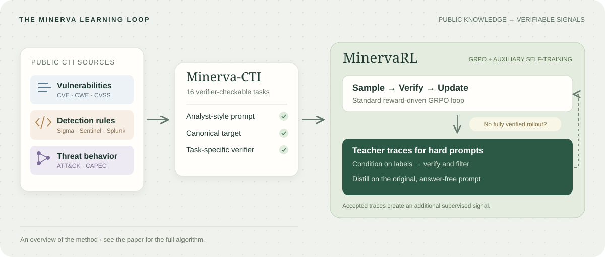

# Minerva

**Reinforcement Learning with Verifiable Rewards for Cyber Threat Intelligence LLMs**

**Accepted at Transactions on Machine Learning Research (TMLR), 2026.**

Md Tanvirul Alam · Aritran Piplai · Ionut Cardei · Nidhi Rastogi · Peter J Worth Jr

[Paper on OpenReview](https://openreview.net/forum?id=w1IMu9exKC) ·
[Camera-ready PDF](docs/assets/pdfs/minerva-camera-ready.pdf) ·
[Code](https://github.com/Athena-Software-Group/minerva) ·
[Project page](https://maveryn.github.io/minerva-tmlr/)



Minerva studies reinforcement learning with verifiable rewards for cyber threat
intelligence. **Minerva-CTI** contains 32,000 training examples across 16 tasks,
with canonical targets and task-specific verifiers. **MinervaRL** supplements
standard GRPO with verified, filtered teacher traces for hard prompts, distilled
onto the original, answer-free prompts.

Across four backbones and 12 CTI evaluation benchmarks, MinervaRL improves the
mean score by **15.8 percentage points over the corresponding base models** and
**4.3 points over GRPO**. Gains vary by task and backbone; paired bootstrap
intervals measure evaluation-example uncertainty for fixed checkpoints.

| Backbone | Base | GRPO | MinervaRL |
| --- | ---: | ---: | ---: |
| Llama-3.1-8B | 48.6 | 56.0 | **60.2** |
| Llama-3.2-3B | 33.1 | 42.1 | **48.3** |
| Qwen3-8B | 37.6 | 47.0 | **53.4** |
| Qwen3-4B | 27.6 | 47.6 | **48.0** |

Values are the 12-task macro averages from Table 1 under greedy single-sample
decoding. Llama backbones start from Instruct checkpoints; Qwen3 backbones start
from Base checkpoints. The page includes the controlled STaR-CTI, DART-CTI, and
LUFFY-CTI comparisons and an expandable per-task table.

## Project-page source

This repository hosts the paper page. The research and training code is in
[Athena-Software-Group/minerva](https://github.com/Athena-Software-Group/minerva).

The page is generated with [paperpage](https://github.com/maveryn/paperpage),
following the same static `docs/` deployment layout as the CTIBench and Sphinx
pages. It includes an original SVG overview, method explanation, data-driven
result chart, complete controlled-baseline scores, paper training curves, and
copyable BibTeX. The SVG illustrations are generated by `scripts/draw_figures.py`.

Rebuild from the committed inputs:

```sh
python -m pip install -r requirements.txt
python scripts/build_site.py
```

Preview locally:

```sh
python -m http.server 8000 --directory docs
```

Open `http://localhost:8000`. The generated page has no runtime dependencies,
analytics, account system, or external JavaScript. It works without JavaScript;
JavaScript adds the copy-citation button.

Edit `paperpage.yml` for page curation, `site/paper.yml` for the published
manuscript metadata, and `site/results.json` for the reported table data. Source
figures and the camera-ready PDF live in `site/assets/`. Update the generator
theme in `tools/paperpage/src/paperpage/templates/minerva-research/` before
rebuilding; avoid hand-editing generated `docs/` files.

The source snapshot was checked against the camera-ready manuscript on
2026-10-21. The `paperpage` revision and compatibility changes are recorded in
[tools/paperpage/UPSTREAM.md](tools/paperpage/UPSTREAM.md); its MIT license is
preserved alongside the vendored code.

## GitHub Pages

Publish from the `main` branch and `/docs` folder in **Settings → Pages**.
The intended project-page URL is `https://maveryn.github.io/minerva-tmlr/`.
`docs/.nojekyll` allows GitHub Pages to serve the generated files directly.

## Citation

If you use Minerva, please cite the paper:

```bibtex
@article{alam2026minerva,
  title = {Minerva: Reinforcement Learning with Verifiable Rewards for Cyber Threat Intelligence LLMs},
  author = {Alam, Md Tanvirul and Piplai, Aritran and Cardei, Ionut and Rastogi, Nidhi and Worth, Jr., Peter J},
  journal = {Transactions on Machine Learning Research},
  year = {2026},
  url = {https://openreview.net/forum?id=w1IMu9exKC}
}
```

[Download BibTeX](CITATION.bib) · [Read the paper](https://openreview.net/forum?id=w1IMu9exKC)
